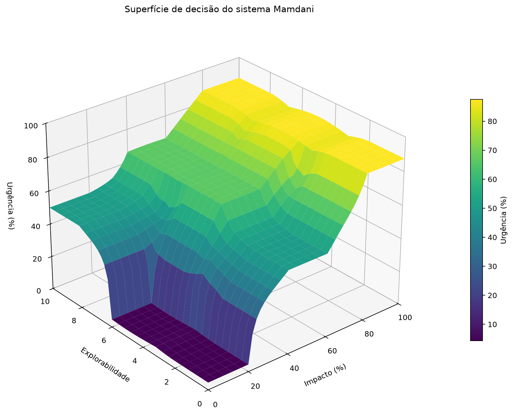

# Resultados — Aula 10: Motor Mamdani e superfície 3D

## 1. Sistema modelado

O laboratório implementa um sistema de inferência fuzzy Mamdani para atribuir a **urgência de um incidente** a partir de duas entradas: **impacto** (0 a 100%) e **explorabilidade** (0 a 10). As funções de pertinência das entradas se sobrepõem para representar as transições entre os termos baixo, médio e alto. A saída é dada em percentual de urgência.

O arquivo `lab01_aula10.py` cria o sistema, executa os testes dos extremos e salva a superfície 3D em `superficie_decisao.png`.

## 2. Matriz de regras codificada

| Impacto \ Explorabilidade | Baixa (0–4) | Moderada (2–8) | Alta (6–10) |
| --- | --- | --- | --- |
| Baixo (0–40) | Urgência baixa | Urgência baixa | Urgência média |
| Médio (20–80) | Urgência média | Urgência alta | Urgência alta |
| Alto (60–100) | Urgência crítica | Urgência crítica | Urgência crítica |

As nove células da tabela foram implementadas como nove regras com o operador **E**. A cobertura das funções de entrada inclui os limites 0 e 100 para impacto e 0 e 10 para explorabilidade; portanto, a grade usada na superfície não possui pontos sem saída.

## 3. Desafio dos extremos

### Por que o centroide não retorna 0% e 100%?

O método `centroid` calcula o centro de massa da área fuzzy agregada, e não o ponto de maior pertinência. No caso mínimo, apenas a regra de urgência baixa é ativada. A função triangular usada é `[0, 0, 13]`; o centroide desse triângulo está em `13 / 3 = 4,33`, por isso a saída não é 0%.

No caso máximo, a urgência crítica triangular é `[62,5, 100, 100]`. Seu centroide fica em `(62,5 + 100 + 100) / 3 = 87,50`. Como a área do triângulo ocupa valores abaixo de 100, seu centro de massa é puxado para a esquerda. Em ambos os casos, isso é uma consequência geométrica esperada do centroide.

### Comparação executada

| Configuração | Impacto = 0, Explorabilidade = 0 | Impacto = 100, Explorabilidade = 10 |
| --- | ---: | ---: |
| Centroide + triângulos | 4,33% | 87,50% |
| Centroide + trapézio crítico `[62,5, 85, 100, 100]` | 4,33% | 86,07% |
| MOM + triângulos | 0,00% | 100,00% |

Na abordagem A, o trapézio crítico cria uma faixa de pertinência máxima entre 85 e 100. Com o centroide, o resultado continua sendo uma média geométrica da área e, neste ajuste, ficou em 86,07%; portanto, apenas trocar o triângulo por trapézio **não força** a saída a 100%.

Na abordagem B, `MOM` (*Mean of Maximum*) calcula a média dos pontos de pertinência máxima. Nos triângulos de borda, o único máximo da urgência baixa está em 0 e o da urgência crítica está em 100, produzindo exatamente 0% e 100%.

Para um sistema que prioriza transições suaves em toda a escala, o centroide é o método mais natural; a forma das funções pode ser ajustada sem provocar escolhas bruscas. Se a regra do negócio exigir obrigatoriamente 0% e 100% nos limites, `MOM` é a alternativa entre as duas testadas que satisfaz esse requisito, com a contrapartida de poder gerar patamares menos suaves em regiões de empate. Uma solução prática é manter o centroide no intervalo interno e tratar os limites absolutos como regras explícitas de negócio.

## 4. Análise da superfície de decisão 3D



A superfície confirma o comportamento da matriz de regras:

- Com impacto baixo, a urgência permanece baixa para explorabilidade baixa ou moderada e sobe para a região média quando a explorabilidade é alta.
- Na faixa de impacto médio, a superfície se eleva: explorabilidade baixa leva a urgência média e os demais níveis levam a urgência alta.
- A partir do impacto alto, a superfície forma a região superior de urgência crítica independentemente da explorabilidade, conforme as três últimas regras.

As inclinações entre regiões são geradas pela sobreposição das funções de pertinência. As cristas visíveis indicam a troca gradual de predominância entre conjuntos e regras; não há lacunas na malha calculada. A figura foi produzida pelo código usando o método do centroide e salva como `superficie_decisao.png`.

## 5. Como executar

Na raiz do repositório:

```powershell
python -m pip install -r AULA_10/requirements.txt
python AULA_10/lab01_aula10.py
```

O programa exibe a tabela do desafio dos extremos e recria a imagem da superfície 3D.
